# SANDRO CRM · Manual de uso e POPs

**O poder da conexão.** Clientes, funil de vendas e follow-ups da sua equipe em um só lugar.

Endereço: **https://sandro-crm.netlify.app** · Funciona no computador e no celular, sem instalar nada.

> As telas deste manual usam a empresa fictícia "Loja Demonstração". Os nomes, e-mails e documentos são de exemplo.

## Sumário

1. Perfis de acesso
2. Entrar no sistema e primeiro acesso
3. Navegação
4. Dashboard
5. Clientes e cadastro de lead
6. Detalhe do cliente: interações, follow-ups e oportunidades
7. Recorrências
8. Funil de Vendas e reciclagem
9. Follow-ups
10. Relatórios (Gestor)
11. Importar e exportar planilhas (Gestor)
12. Configurações (Gestor)
13. Uso no celular
14. POPs: procedimentos do dia a dia
15. Perguntas frequentes

## 1. Perfis de acesso

| Tela | Gestor | Atendimento |
|---|---|---|
| Dashboard, Clientes, Funil de Vendas, Follow-ups | ✓ | ✓ |
| Relatórios | ✓ | — |
| Configurações (usuários, horários, automação) | ✓ | — |
| Importar / exportar planilhas | ✓ | — |
| Excluir clientes e recorrências | ✓ | — |

O **Gestor** administra a equipe e acompanha os resultados. O **Atendimento** opera o dia a dia: clientes, funil e follow-ups.

## 2. Entrar no sistema e primeiro acesso

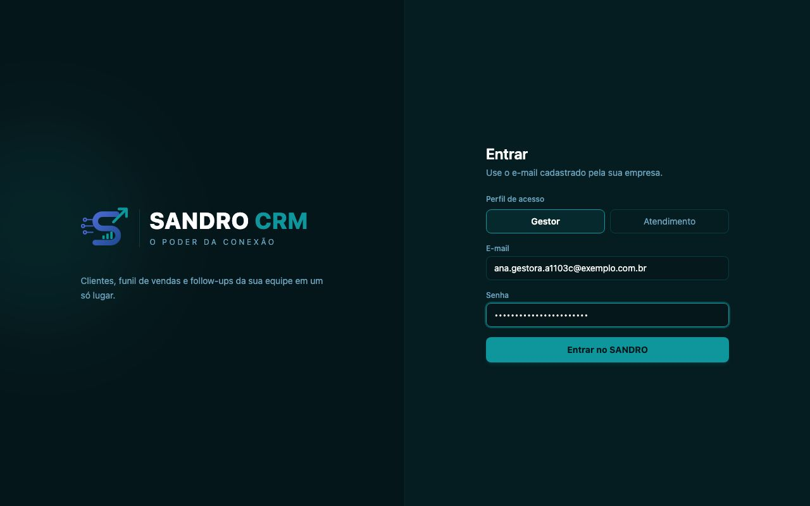

1. Escolha o **Perfil de acesso** (Gestor ou Atendimento) do seu usuário.
2. Digite **E-mail** e **Senha** e clique em **Entrar no SANDRO**.

Mensagens que podem aparecer:

| Mensagem | O que fazer |
|---|---|
| "Esta conta é do perfil …" | Marque o perfil indicado e entre de novo |
| "E-mail ou senha inválidos." | Confira os dados. Após 5 tentativas erradas, a conta fica bloqueada por 15 minutos |
| "Fora do seu horário de acesso" | Sua jornada não inclui este horário. Fale com o Gestor |
| "Sua senha temporária expirou." | Peça ao Gestor uma nova (validade: 72 horas) |

**Primeiro acesso.** Sua conta começa com uma senha temporária, entregue pelo Gestor. Ao entrar, o sistema pede uma senha pessoal:

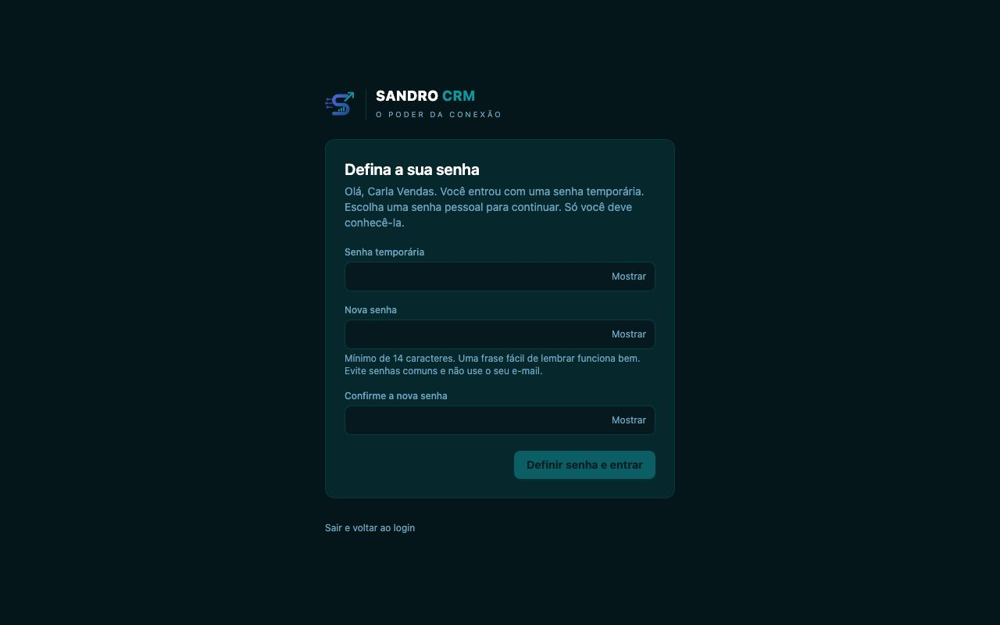

- A nova senha precisa de **pelo menos 14 caracteres**. Uma frase fácil de lembrar funciona bem, por exemplo "cafe com pao na esquina".
- Não use o seu e-mail nem senhas comuns. Ninguém da empresa deve saber a sua senha.

**Horário de acesso.** Se o Gestor definiu uma jornada para você, ela aparece no rodapé do menu. Cinco minutos antes do fim, o sistema avisa. No horário, a sessão é encerrada sozinha:

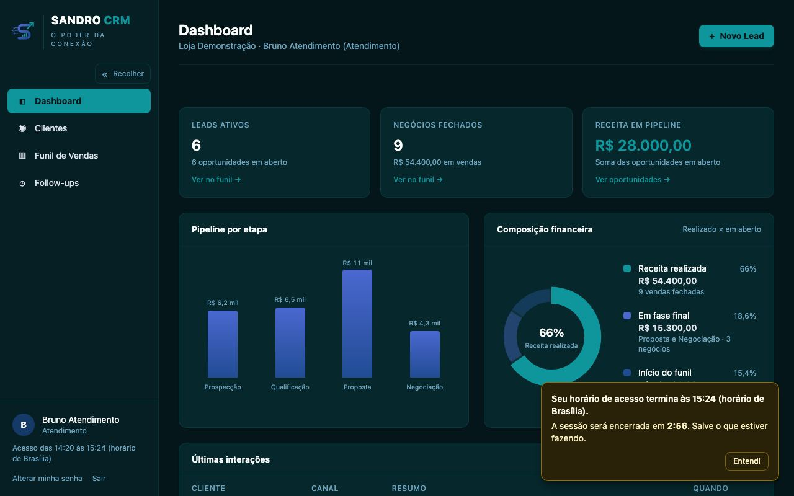

**Trocar a senha.** No menu, clique em **Alterar minha senha**. Suas outras sessões abertas são encerradas.

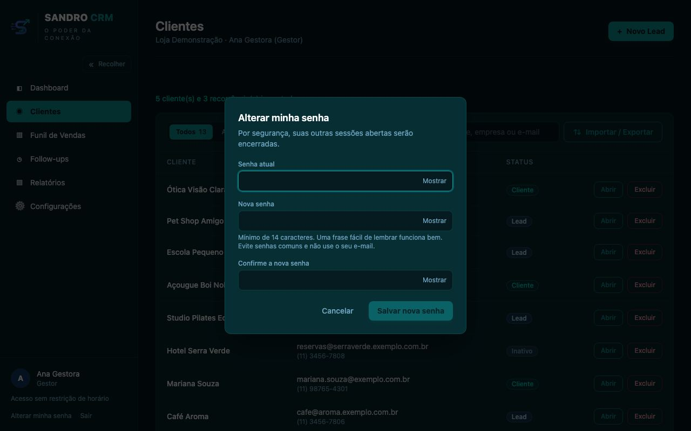

## 3. Navegação

- **Menu lateral:** Dashboard, Clientes, Funil de Vendas, Follow-ups e, para o Gestor, Relatórios e Configurações. "Recolher" deixa só os ícones.
- **"+ Novo Lead"** (canto superior direito) funciona em qualquer tela.
- No rodapé do menu ficam seu nome, a jornada de acesso, **Alterar minha senha** e **Sair**.

## 4. Dashboard

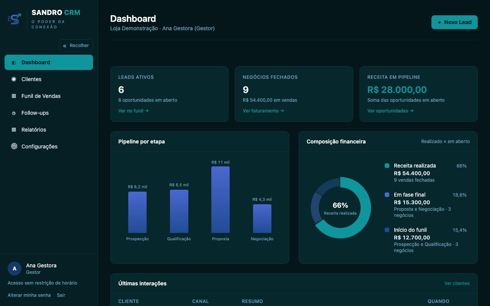

- **Leads ativos, Negócios fechados e Receita em pipeline:** clique no card para ir à tela com os detalhes.
- **Pipeline por etapa:** valor em aberto em cada fase do funil.
- **Composição financeira:** quanto já foi vendido em relação ao que ainda está em negociação.
- **Últimas interações** e, no rodapé, a data da última atualização e o botão "↻ Atualizar agora".

## 5. Clientes e cadastro de lead

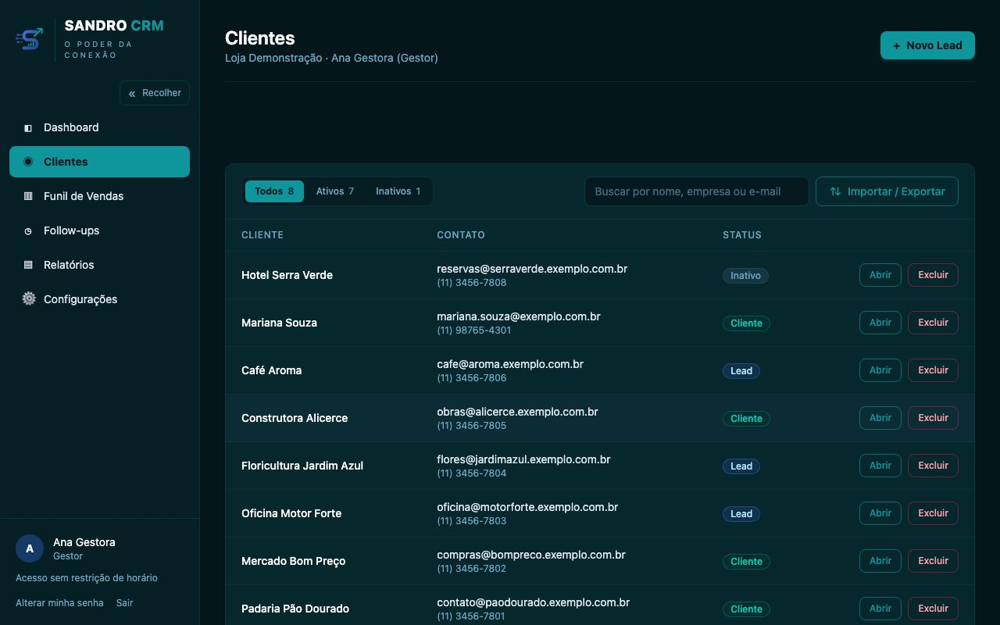

- Filtre por **Todos / Ativos / Inativos** e busque por nome ou e-mail (a busca ignora acentos).
- **Abrir** mostra o detalhe. **Excluir** é exclusivo do Gestor e apaga o histórico de interações; as vendas continuam nos relatórios.

**Cadastrar um lead:** clique em **+ Novo Lead**.

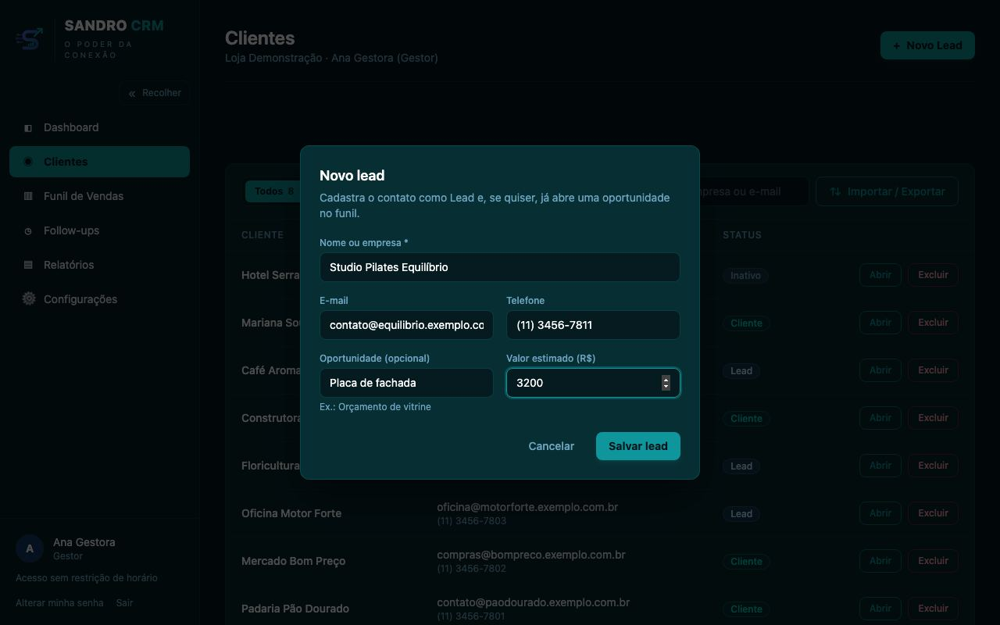

- Só **Nome ou empresa** é obrigatório.
- Se preencher **Oportunidade**, o sistema já cria o card no funil, em Prospecção.

## 6. Detalhe do cliente

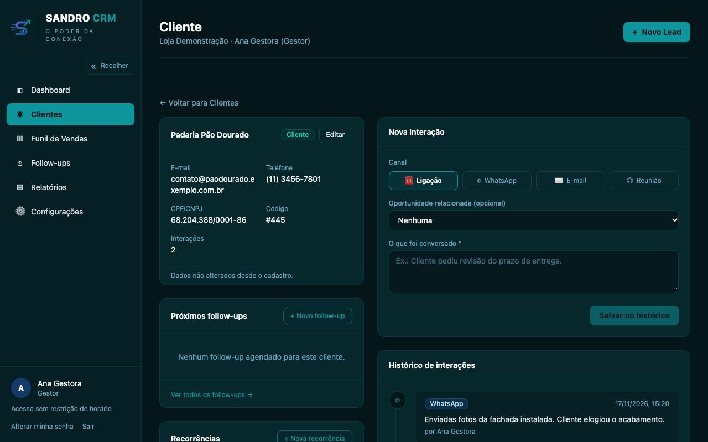

**Esquerda:** dados do cliente, próximos follow-ups, recorrências e oportunidades. **Direita:** nova interação e histórico.

- **Editar:** nome, e-mail, telefone, **CPF/CNPJ** (com ou sem pontuação; aceita o CNPJ com letras) e status (Lead, Cliente, Inativo).

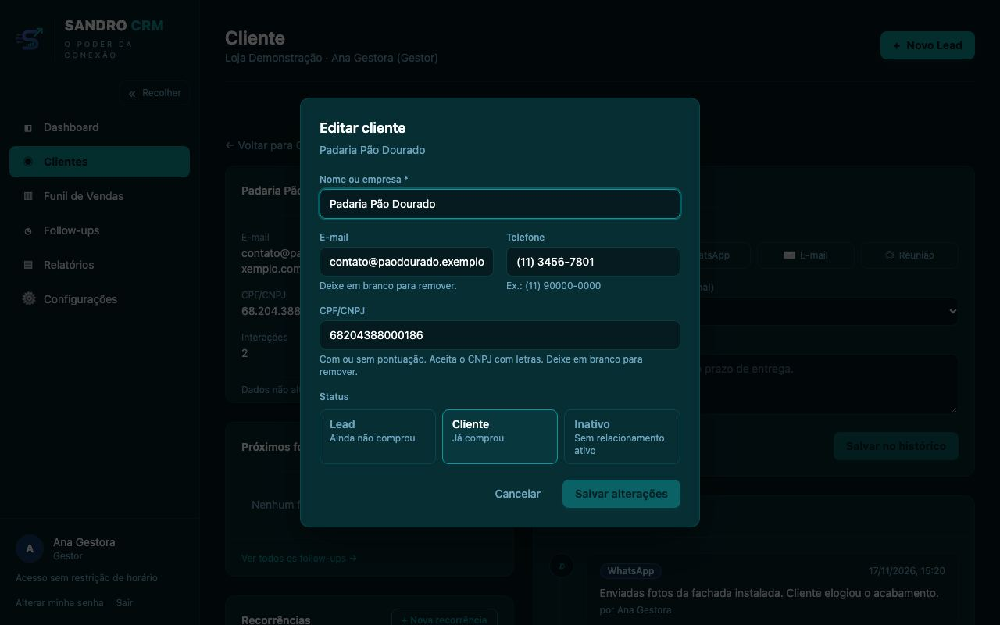

- **Nova interação:** escolha o canal (Ligação, WhatsApp, E-mail, Reunião), descreva a conversa e clique em **Salvar no histórico**. Depois, o sistema oferece **Agendar próximo contato**.
- **+ Novo follow-up:** escolha o que fazer e quando ("Hoje", "Amanhã", "Em 3 dias", "Em 1 semana" ou uma data).

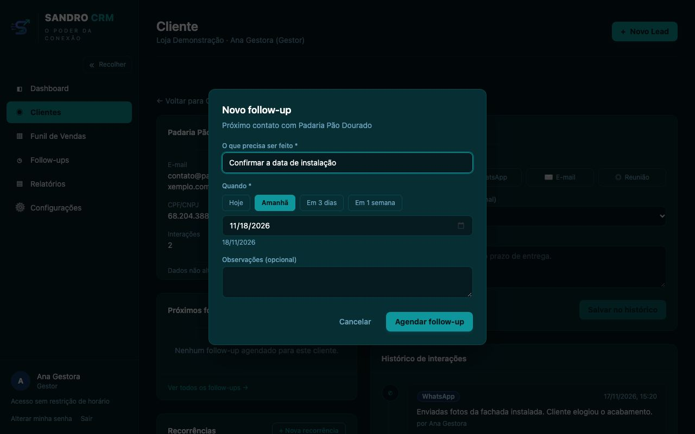

## 7. Recorrências

Use para clientes com rotina: **"compra toda segunda"**, **"fechamento todo dia 5"**.

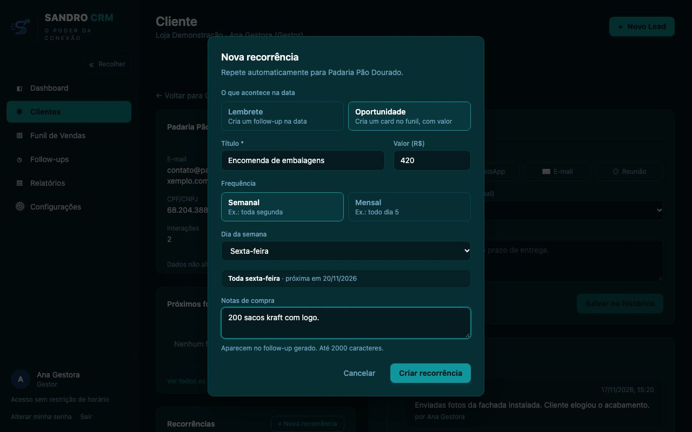

1. No detalhe do cliente, card **Recorrências** → **+ Nova recorrência**.
2. Escolha **o que acontece na data**:
   - **Lembrete:** cria um follow-up na data, com as notas.
   - **Oportunidade:** cria um card em Prospecção com o valor informado.
3. Escolha **Semanal** (dia da semana) ou **Mensal** (dia do mês). O formulário mostra a próxima data.
4. Em **Notas de compra**, escreva o que costuma ser pedido.

Regras importantes:
- "Todo dia 31" vale como o último dia nos meses mais curtos.
- **Pausar** interrompe a regra. Ao **retomar**, ela volta a contar a partir de hoje; as datas do período pausado não são geradas.
- Clientes **Inativos** não geram eventos.
- Excluir a regra (só o Gestor) não apaga os follow-ups e cards já criados.

Também dá para repetir uma oportunidade ao criá-la, marcando **Repetir automaticamente**:

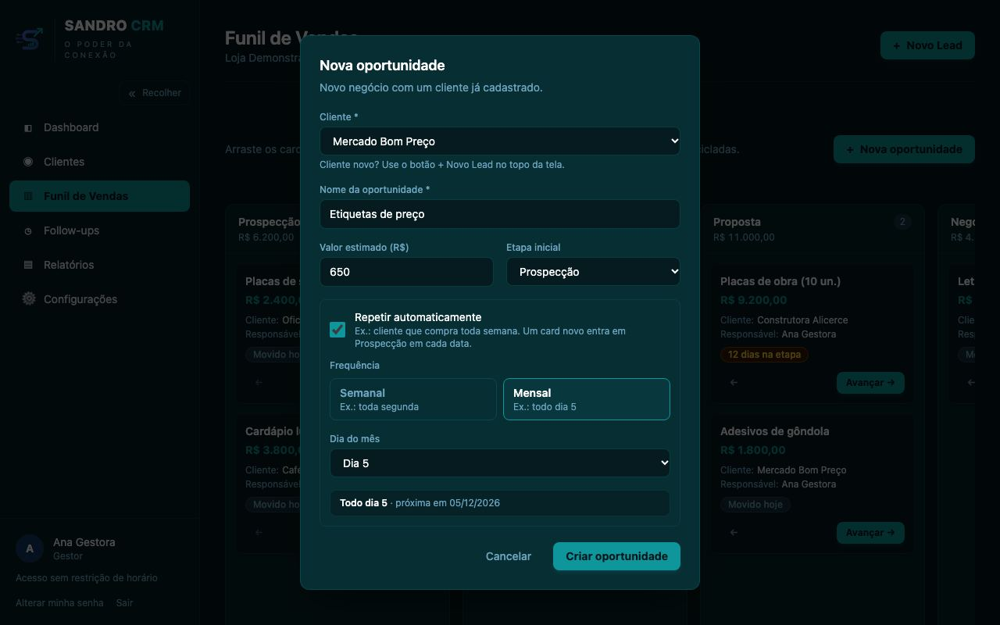

## 8. Funil de Vendas

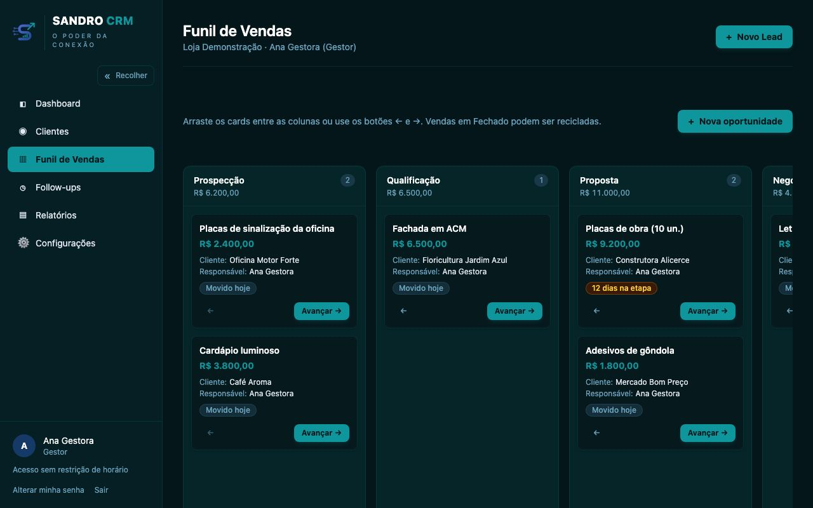

- Etapas: **Prospecção → Qualificação → Proposta → Negociação → Fechado**.
- Mova um card **arrastando** ou com os botões **Avançar →** e **←**.
- A etiqueta "N dias na etapa" fica laranja a partir de 7 dias parado.
- **Fechado** conta como venda na receita.

**Reciclar lead (pós-venda).** Num card em Fechado, **↻ Reciclar Lead** agenda uma nova oportunidade para o mesmo cliente daqui a 7, 10, 15 ou 30 dias, em outro período ou numa data. A venda original continua na receita.

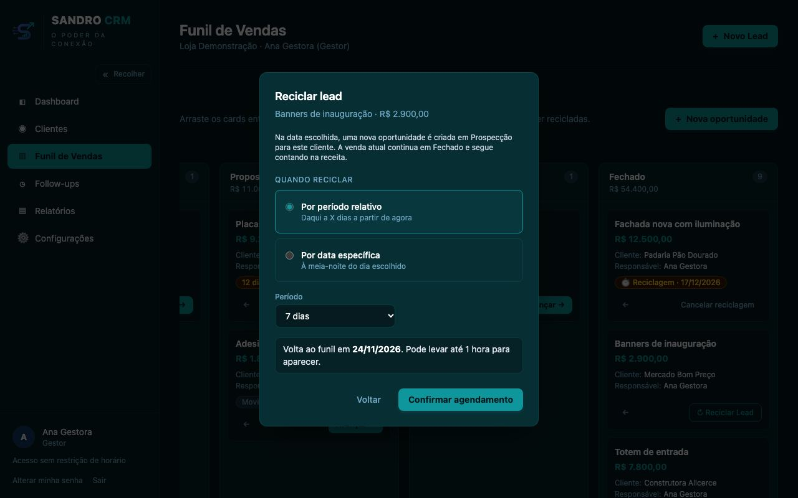

## 9. Follow-ups

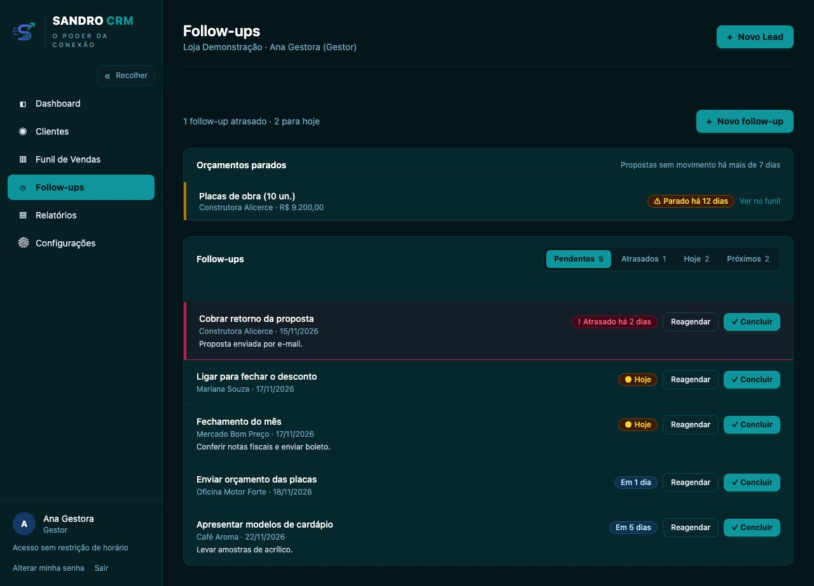

- **Orçamentos parados:** propostas sem movimento há mais dias do que o prazo definido em Configurações (padrão: 7).
- Abas **Pendentes, Atrasados, Hoje e Próximos**. Atrasados ficam em vermelho.
- **✓ Concluir** tira o item da lista. **Reagendar** muda a data.

## 10. Relatórios (Gestor)

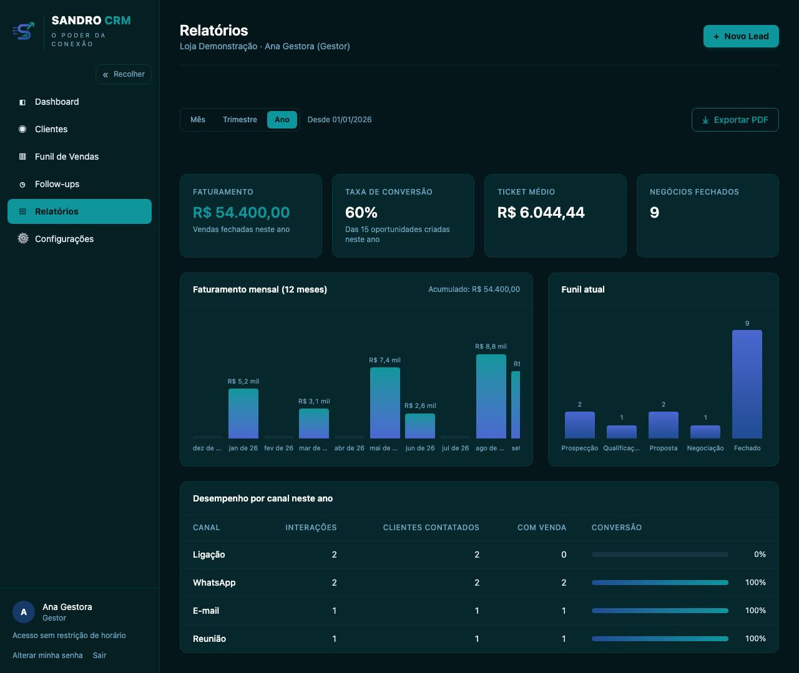

- Período: **Mês, Trimestre ou Ano**.
- Faturamento, taxa de conversão, ticket médio, negócios fechados, faturamento dos últimos 12 meses, funil atual e desempenho por canal.
- **Exportar PDF** gera o relatório de faturamento do período com a marca SANDRO.

## 11. Importar e exportar planilhas (Gestor)

Em **Clientes → Importar / Exportar**.

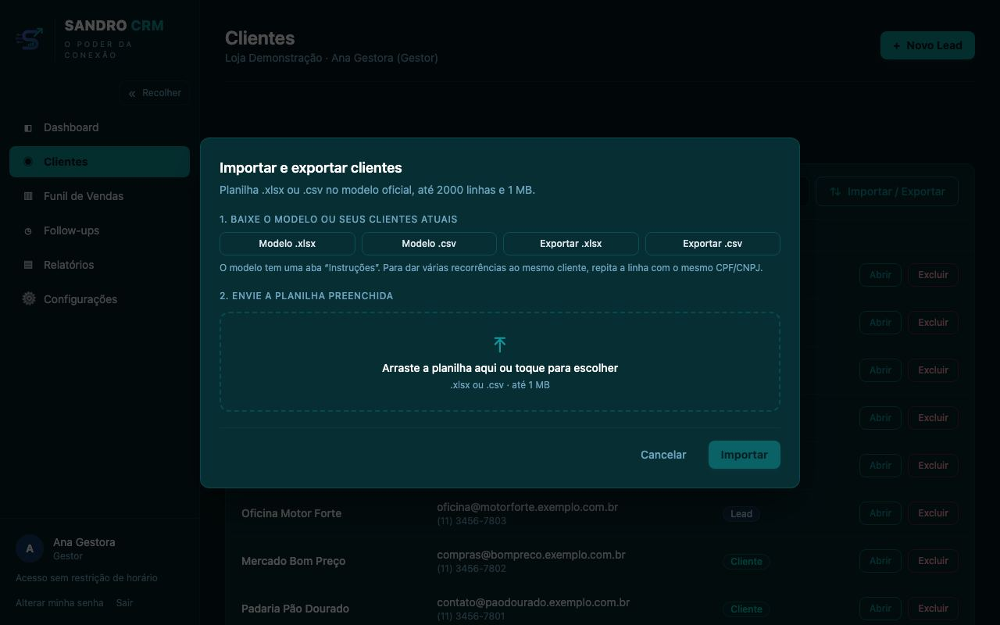

**Passo 1. Baixe o modelo** (.xlsx ou .csv). O .xlsx tem a aba "Instruções" e listas suspensas.

| Coluna | Como preencher |
|---|---|
| Nome do cliente * | Obrigatório |
| CPF/CNPJ | Opcional. Repita o mesmo CPF/CNPJ em várias linhas para dar várias recorrências ao cliente |
| E-mail, Telefone | Opcionais |
| Status | Lead, Cliente ou Inativo (vazio = Lead) |
| Recorrência: tipo / frequência / dia | Ex.: `oportunidade · semanal · segunda` ou `lembrete · mensal · 5` |
| Recorrência: título, Valor (R$), Notas de compra | Valor só para oportunidade, ex.: 1.250,90 |

**Passo 2. Envie a planilha**, arrastando o arquivo para a área tracejada ou clicando nela.

**Se houver erro, nada é importado.** O sistema mostra a linha, a coluna e o motivo:

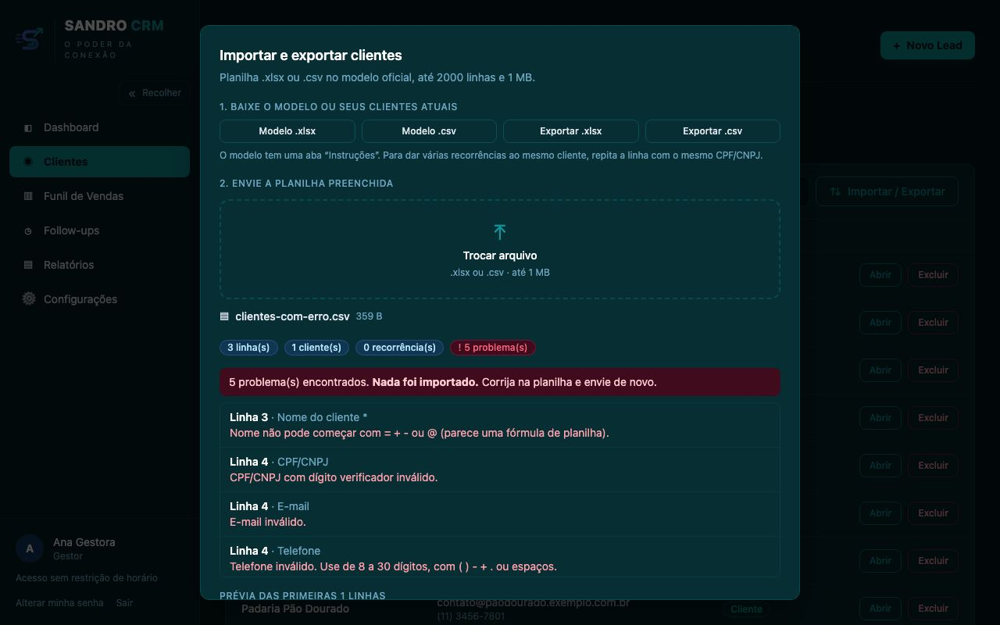

Por segurança, o sistema recusa células que começam com `=`, `+`, `-` ou `@` (parecem fórmulas), textos com marcação HTML, planilhas com macros e arquivos acima de 1 MB ou de 2000 linhas.

**Passo 3. Confira a prévia** das primeiras 5 linhas e clique em **Importar**:

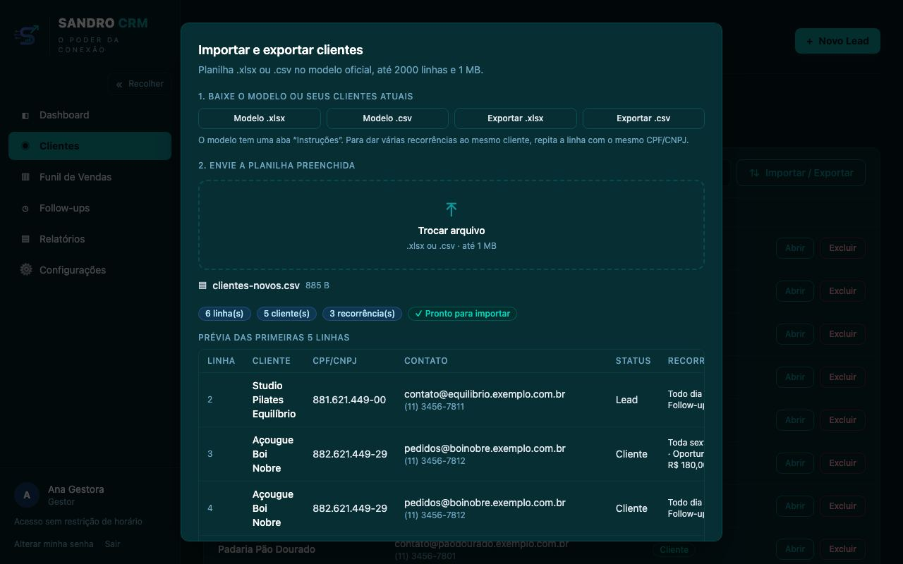

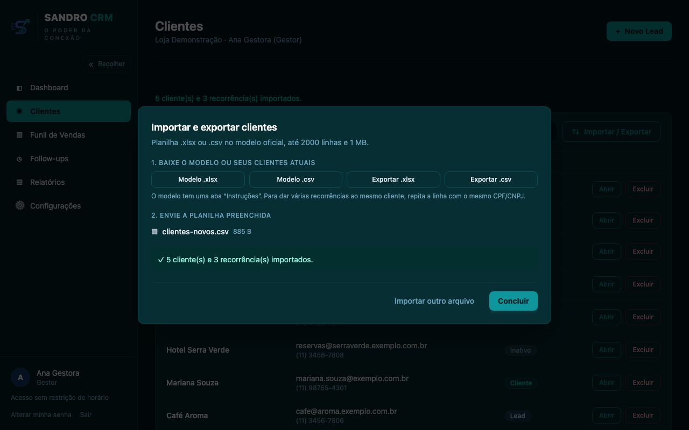

**Exportar:** "Exportar .xlsx/.csv" baixa os clientes da empresa no mesmo formato do modelo.

## 12. Configurações (Gestor)

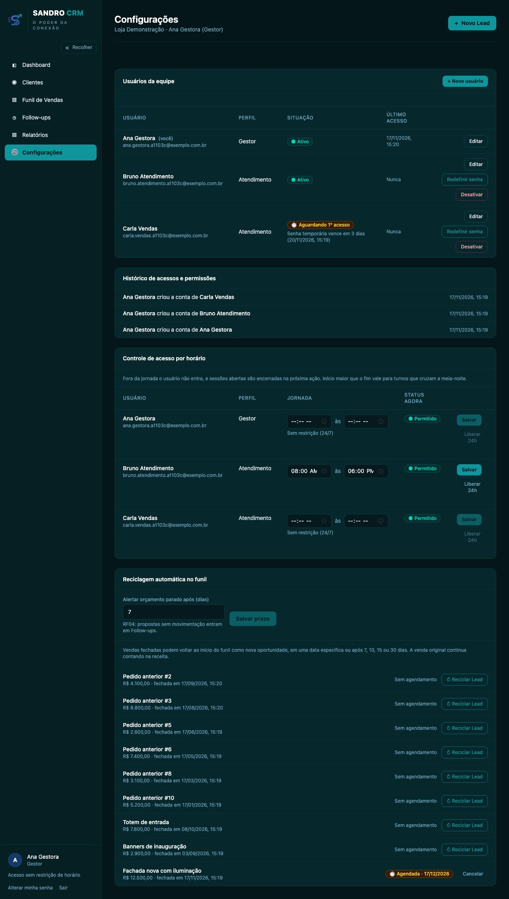

**Usuários da equipe**
- **+ Novo usuário:** nome, e-mail e perfil.

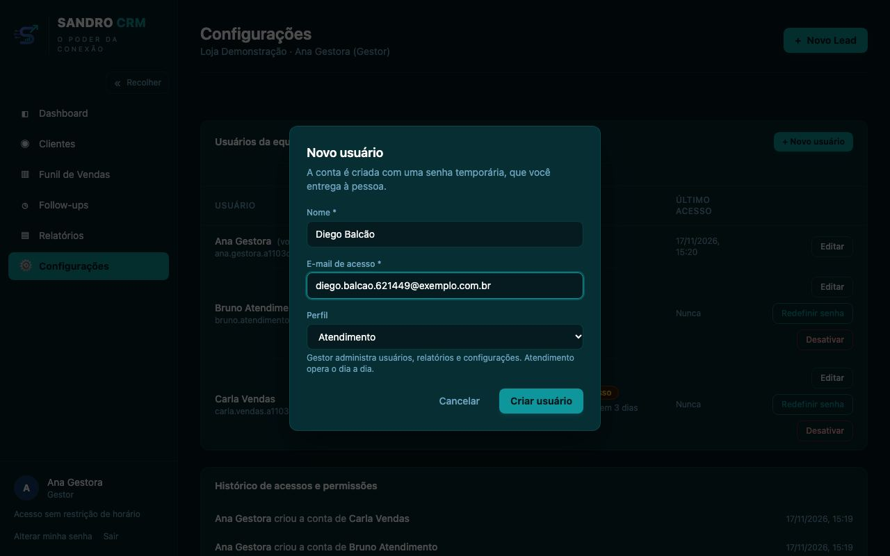

- O sistema mostra a **senha temporária uma única vez**. Entregue por um canal seguro (pessoalmente ou por mensagem privada, nunca em grupo) e clique em **Já entreguei a senha**.

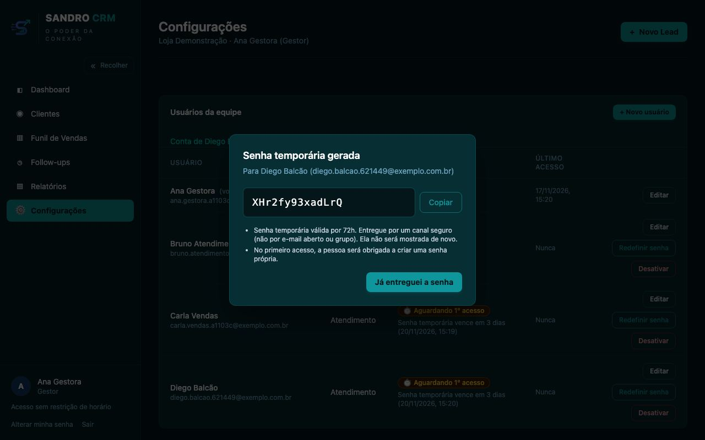

- **Situação:** Ativo, Bloqueado, Desativado, "Aguardando 1º acesso · vence em …" ou "Senha temporária expirada há …".
- **Redefinir senha:** gera nova senha temporária e encerra as sessões da pessoa.
- **Desativar / Reativar:** a conta nunca é apagada; o histórico continua.
- **Histórico de acessos e permissões:** quem criou, alterou, redefiniu ou desativou cada conta.

**Controle de acesso por horário:** defina início e fim da jornada de cada pessoa e clique em **Salvar**. **Liberar 24h** tira a restrição. Início maior que o fim vale para turnos que passam da meia-noite.

**Reciclagem automática no funil:** prazo do alerta de orçamento parado e lista das vendas fechadas para agendar pós-venda.

## 13. Uso no celular

| Menu | Clientes | Funil |
|---|---|---|
| 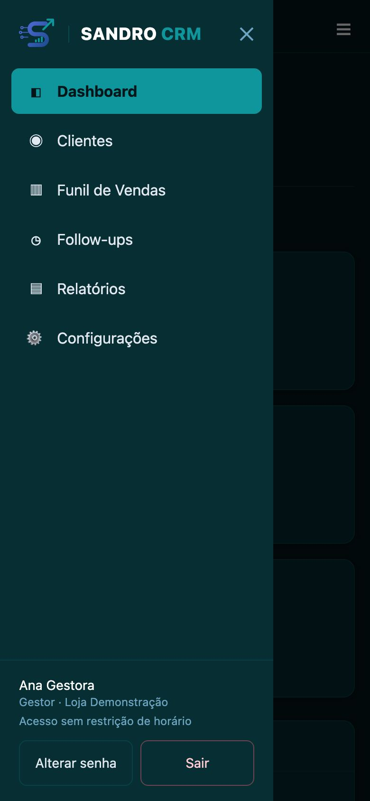 | 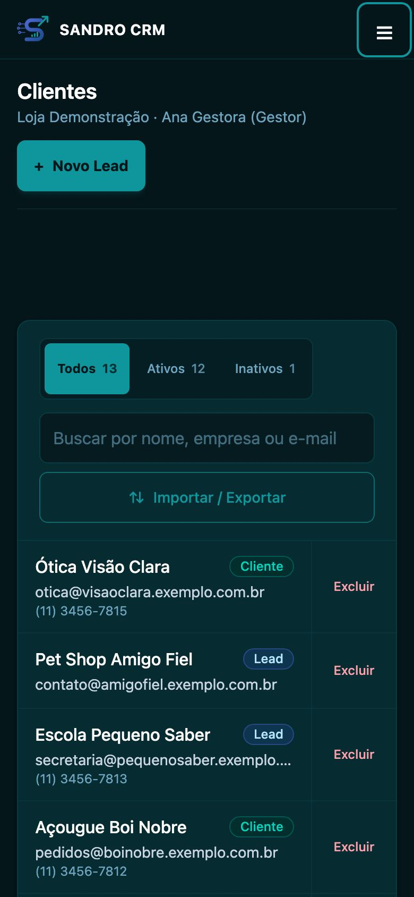 | 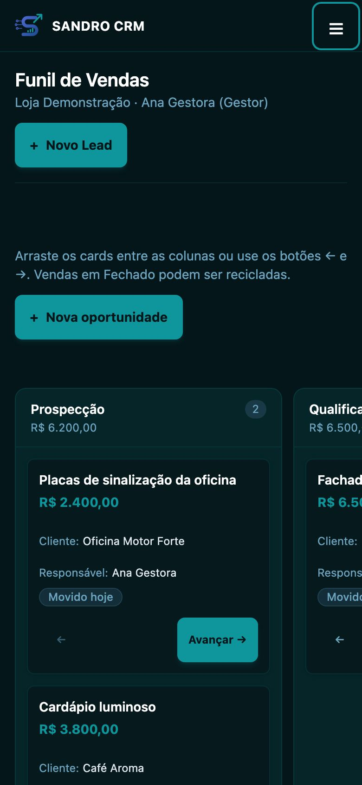 |

- O menu abre no **☰** do canto superior direito.
- Clientes aparecem em cartões; toque no cartão para abrir.
- No funil, deslize para ver cada etapa.
- Formulários abrem de baixo para cima e acompanham o teclado.

| Dashboard | Recorrências | Importação |
|---|---|---|
| 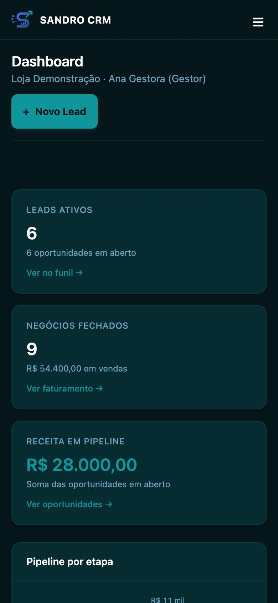 | 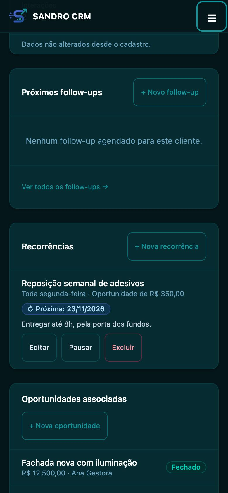 | 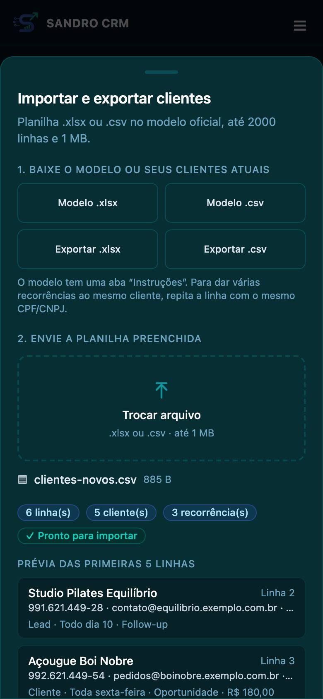 |

## 14. POPs: procedimentos do dia a dia

**POP 01 · Atender um contato novo** (Atendimento)
1. Clique em **+ Novo Lead**, preencha nome e contato. Se já houver pedido, preencha a oportunidade e o valor.
2. No cliente aberto, registre a conversa em **Nova interação**.
3. Clique em **Agendar próximo contato** e escolha a data.

**POP 02 · Começar o dia** (Atendimento)
1. Abra **Follow-ups** e trate primeiro **Atrasados**, depois **Hoje**.
2. Para cada contato feito: registre a interação no cliente e clique em **✓ Concluir** (ou **Reagendar**).
3. Veja **Orçamentos parados** e retome essas propostas.

**POP 03 · Avançar uma venda** (Atendimento)
1. No **Funil**, mova o card para a etapa certa sempre que a negociação andar.
2. Ao fechar, mova para **Fechado**. Se o cliente costuma voltar, use **↻ Reciclar Lead**.

**POP 04 · Cadastrar cliente com compra recorrente** (Atendimento ou Gestor)
1. No cliente, **+ Nova recorrência** → Oportunidade (pedido com valor) ou Lembrete (tarefa).
2. Escolha semanal/mensal e o dia. Escreva o pedido habitual em **Notas de compra**.

**POP 05 · Importar uma lista de clientes** (Gestor)
1. **Clientes → Importar / Exportar → Modelo .xlsx**. Não mude os títulos das colunas.
2. Preencha e envie. Se aparecerem erros, corrija as linhas indicadas e envie de novo.
3. Confira a prévia e clique em **Importar**.

**POP 06 · Entrada de um funcionário** (Gestor)
1. **Configurações → + Novo usuário**, com o perfil certo.
2. Entregue a senha temporária pessoalmente ou por mensagem privada (vale 72 h).
3. Se houver jornada, defina em **Controle de acesso por horário**.

**POP 07 · Saída de um funcionário** (Gestor)
1. **Configurações → Desativar** na conta da pessoa, no mesmo dia. O acesso cai na hora, inclusive no celular.
2. Não compartilhe nem reaproveite a conta: crie outra para quem entrar no lugar.

**POP 08 · Fechamento do mês** (Gestor)
1. **Relatórios → Mês** e **Exportar PDF**.
2. Confira **Orçamentos parados** em Follow-ups e redistribua as propostas.
3. Se quiser uma cópia da base, **Clientes → Importar / Exportar → Exportar .xlsx**.

## 15. Perguntas frequentes

**Esqueci a senha.** Peça ao Gestor para usar **Redefinir senha**. Não há recuperação por e-mail: o Gestor controla o acesso.

**A conta foi bloqueada.** Após 5 senhas erradas, espere 15 minutos ou peça ao Gestor para redefinir.

**A sessão fechou sozinha.** Pode ser o fim da sua jornada, a validade do login (8 horas) ou uma troca de senha. Entre de novo.

**A planilha não entra.** Leia a lista de erros: ela indica linha e coluna. Corrija e envie de novo. Nada fica pela metade.

**Posso usar no celular?** Sim, pelo navegador, no mesmo endereço.

**Meus dados são vistos por outras empresas?** Não. Cada empresa só enxerga os próprios clientes, vendas e usuários.
